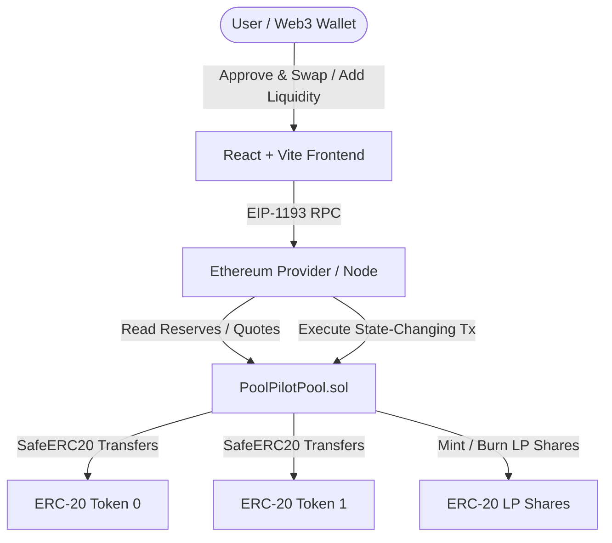

# PoolPilot System Architecture

This document describes the software architecture, on-chain responsibilities, frontend architecture, and operational security boundaries of **PoolPilot**.

---

## 1. System Overview

PoolPilot is an automated market maker (AMM) enabling non-custodial token swaps and permissionless liquidity provision using the constant-product model ($x \cdot y = k$).

---

## 2. On-Chain Smart Contract Layer

The smart contract is the single source of truth for:
- Pool reserves and canonical token ordering
- Fee retention and constant-product invariant verification
- Proportional liquidity accounting (minting and burning $PLP$ shares)
- Atomic settlement and slippage protection
- Emitted events for indexers and UIs

### 2.1 Contracts & Interfaces
- **`PoolPilotPool.sol`**: Core AMM contract. Inherits OpenZeppelin's `ERC20` (for LP shares) and `ReentrancyGuard`. Uses `SafeERC20` for token operations.
- **`IPoolPilotPool.sol`**: Complete external interface declaring all methods, custom errors, and events.
- **`MockERC20.sol`**: Configurable ERC-20 implementation for local testing and testnet faucets with a public `mint()` function.

### 2.2 Security Invariants
1. **Canonical Token Ordering**: Ensures `token0 < token1` canonically, preventing duplicate pools for the same pair.
2. **Reentrancy Protection**: All state-changing functions (`swap`, `addLiquidity`, `removeLiquidity`, `sync`) use OpenZeppelin's `nonReentrant` modifier.
3. **Checks-Effects-Interactions (CEI)**: State variables (reserves and share supplies) are updated **before** token transfers occur.
4. **Integer Truncation**: All output values round down to prevent pool depletion.
5. **Inflation Attack Prevention**: 1,000 initial shares are burned to `0x000000000000000000000000000000000000dEaD`.

---

## 3. Frontend Architecture

The frontend is a lightweight, responsive React single-page application built with Vite:

- **State Management**:
  - `useWallet`: Manages wallet connection, account changes, chain validation, and JSON-RPC fallback.
  - `usePoolData`: Polls reserves, token balances, allowances, and LP share ownership.
- **Component Hierarchy**:
  - `Header`: Wallet connection pill, testnet badge, faucet trigger, and data refresh.
  - `DisclaimerBanner`: Non-audited prototype security notification.
  - `PoolOverview`: Real-time pool reserve cards, indicative exchange rates, and user pool share percentage.
  - `SwapCard`: Interactive swap interface with token flip, slippage selector, and approval flow.
  - `LiquidityCard`: Proportional liquidity deposit and redemption sliders.
  - `TransactionModal`: Multi-stage modal tracking wallet signature request, pending broadcast, confirmation, and revert reasons.
  - `FaucetModal`: One-click minting for free test tokens.

---

## 4. Team Responsibilities (Team 404)

- **Yuvraj Kumar**: Database & Data Invariant Architecture (Reserve accounting, price indexing, historical quotes).
- **Yash Singh**: UI/UX Architecture (Glassmorphism design system, interaction feedback, micro-animations).
- **Alwin Mathew**: On-Chain & Backend Architecture (Smart contract invariants, SafeERC20 integrations, RPC pipeline).
